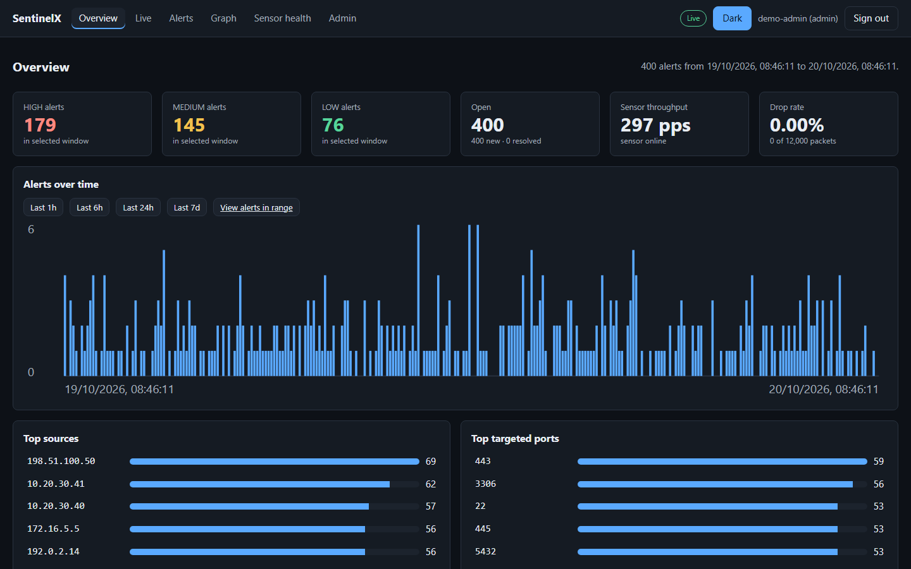
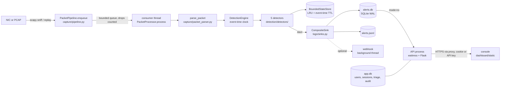
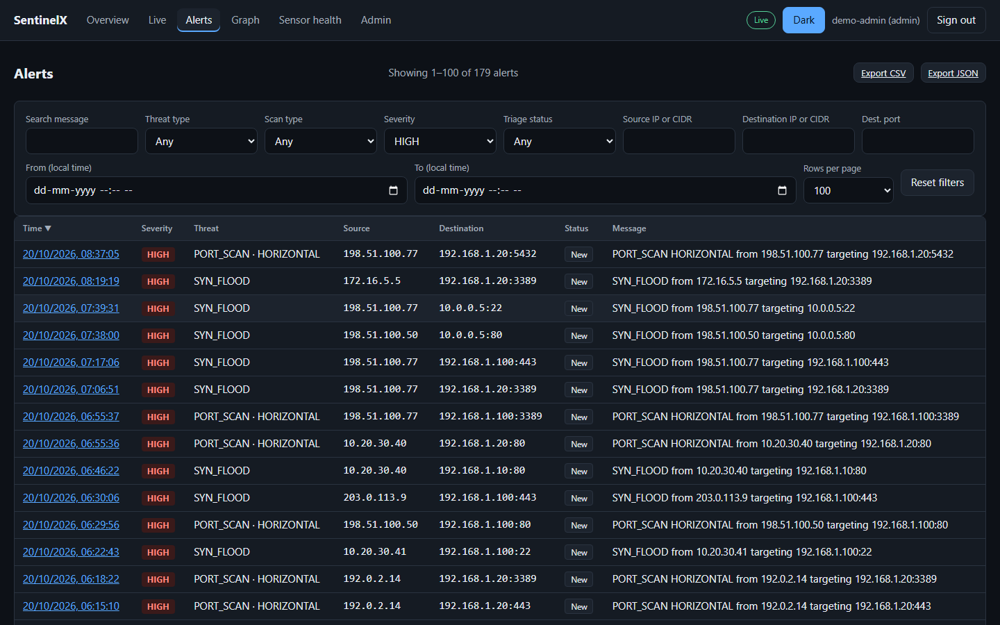
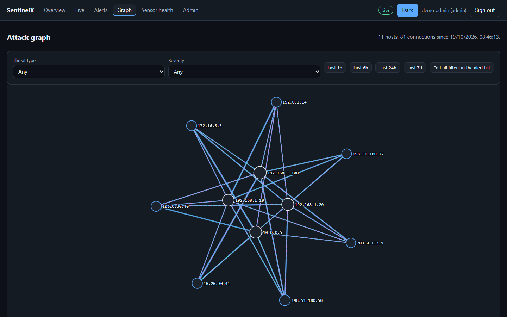
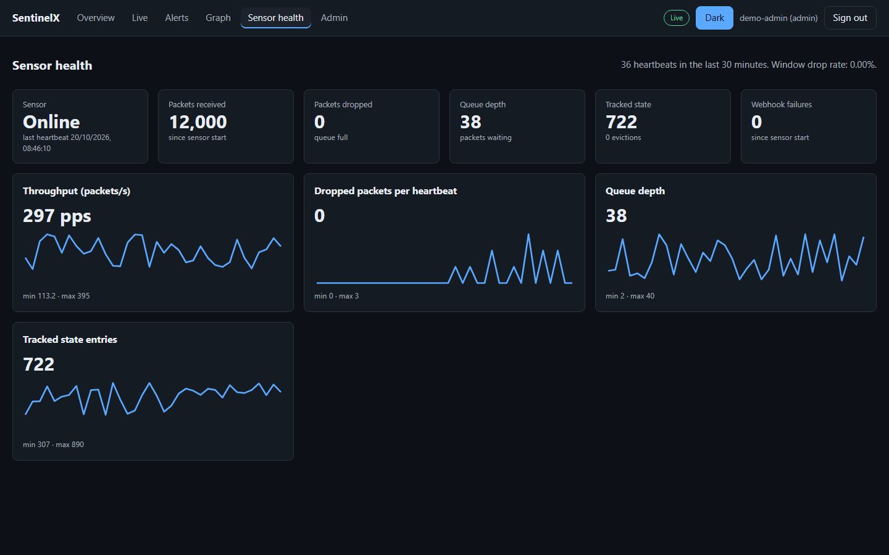
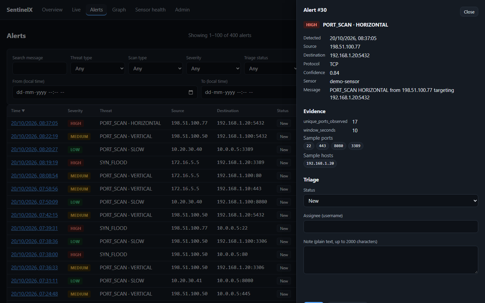

# SentinelX

A passive network intrusion detection system in Python. A sensor process captures packets (or replays a PCAP), runs five rule-based detectors on packet event time, and writes alerts to SQLite and JSONL. A separate API process serves a login-protected console and REST API from a read-only view of those alerts.



## What it is and why it exists

SentinelX watches TCP/UDP header metadata and raises alerts for five patterns: vertical port scans, horizontal sweeps, slow scans, SYN floods and volumetric floods. It is a learning-scale project built to be checked, not trusted on faith: detectors run on packet timestamps so the same PCAP gives the same alerts on any machine, every detector has a documented evasion, and a scenario benchmark runs in CI.

It is a passive monitor on one host. It does not block traffic, inspect payloads, or scale past one CPU core on the packet path (see [Limitations](#limitations)).

## 60-second quickstart

### Linux, Docker

The sensor shares the host network namespace and holds only `NET_RAW`. The API is a separate unprivileged container published on `127.0.0.1:5000`. Live capture inside the container is **not tested in CI** (the CI runs replay and the API); if promiscuous capture fails on your kernel, add `NET_ADMIN` to the sensor and tell us.

```bash
git clone https://github.com/vigneshs-17/SentinelX.git && cd SentinelX
docker compose run --rm api python main.py user add admin --role admin
docker compose up -d
```

Open <http://127.0.0.1:5000/> and sign in as `admin`. Set `SENTINELX_INTERFACE` to pick a NIC. Docker was not run locally while writing this; the image and compose file are exercised only by the CI jobs (`scripts/ci_compose_check.py`), which passed on GitHub Actions for commit `cf2a691` (run 39465667959).

### Windows, Npcap

Docker Desktop cannot capture the host NIC, so run natively. Install [Npcap](https://npcap.com/) (tick "WinPcap API-compatible mode"), then in an **Administrator** PowerShell:

```powershell
git clone https://github.com/vigneshs-17/SentinelX.git; cd SentinelX
python -m venv .venv; .\.venv\Scripts\Activate.ps1
pip install -r requirements.txt
python main.py user add admin --role admin      # prompts for a password
python main.py sensor                           # terminal 1: capture + detection
python main.py api                              # terminal 2: console on http://127.0.0.1:5000/
```

No hardware or admin rights? Replay a capture instead of sniffing: `python main.py replay path/to/file.pcap`.

Requires Python 3.12 or newer.

## Architecture



Two processes (`python main.py sensor`, `python main.py api`) share only the SQLite files. The API opens `alerts.db` read-only and owns `app.db`. Design reasons are in [docs/DESIGN.md](docs/DESIGN.md); a file-by-file trace of one packet is in [docs/WALKTHROUGH.md](docs/WALKTHROUGH.md).

## Detectors

Defaults come from `config/settings.py`; the full list of settings is generated into [docs/OPERATIONS.md](docs/OPERATIONS.md). Time is packet time, not wall-clock time.

| Detector | Fires when (defaults) | Evidence fields | Known evasions |
| --- | --- | --- | --- |
| Vertical scan (`detection/detectors/port_scan.py`) | One source sends TCP SYN to at least 10 distinct ports of one target within 10 s, counting only ports whose handshake did not complete (unanswered, RST, or SYN-ACK without the client's ACK); 30 s cooldown | `unique_ports_observed`, `threshold`, `window_seconds`, `target_host`, `sample_ports` | Fewer than 10 ports per 10 s (see slow scan); non-SYN probes (FIN, NULL, Xmas, UDP); many sources each below the threshold; full `connect()` scans that complete the handshake on open ports (closed ports still count) |
| Horizontal sweep (same file) | One source sends SYN to the same port on at least 10 distinct hosts within 10 s, counting only hosts whose handshake did not complete (many browser tabs to many servers complete theirs and do not alert); 30 s cooldown | `unique_targets_observed`, `threshold`, `window_seconds`, `target_port`, `sample_targets` | Same as above; sweeping many ports across many hosts slowly; a sweep that completes a handshake with each host |
| Slow scan (`slow_scan.py`) | At least 20 distinct ports (or hosts) within 300 s, with the same completed-handshake exclusion; for the horizontal form, also at least 80% of the source's recent attempts to that port must have failed to complete (`SENTINELX_SLOW_SCAN_MIN_FAILURE_RATIO`); 60 s cooldown | `unique_ports_observed` or `unique_targets_observed`, `window_seconds`, `sample_ports` / `sample_targets` | Spreading probes over more than 300 s; distributing over sources; state eviction under a spoofed-source flood; mixing in enough real completed connections to the same port to push failures under 80% |
| SYN flood (`syn_flood.py`) | At least 100 SYN/s to one (host, port) over a 5 s window and handshake completion ratio below 0.2; 30 s cooldown | `syn_rate_pps`, `total_syns`, `total_acks`, `completion_ratio`, `target_host`, `target_port` | Completing handshakes (connection flood); staying under 100 SYN/s per target; high-rate floods that leak ACKs to raise the ratio |
| Volumetric (`volumetric.py`) | Packet or byte rate to one destination exceeds 5 times its EWMA baseline and a floor (1000 pps, 10 MB/s), or a hard ceiling (50,000 pps, 500 MB/s); baseline trusted after 3 windows | `packet_rate_pps`, `byte_rate_bps`, `ewma_pps`, `ewma_bps`, `top_talkers` | Ramping slowly so the baseline follows; staying under the floor; spreading over many destinations |

Severity is `LOW`, `MEDIUM` or `HIGH` from the ratio of the observed value to the threshold (1x medium, 3x high; `detection/scoring.py`).

## Results

What these numbers are: a deterministic synthetic scenario suite (`eval/`) used as a regression net. It is **not** a real-world accuracy claim: perfect scores on scenarios written by the same author as the detectors show that the code does what it was written to do, nothing more. The one real-data experiment (flow-level ML on CIC-IDS2017) has not been run.

<!-- RESULTS:BEGIN (generated by scripts/gen_readme_results.py) -->

Command: `python main.py eval --scenarios all --out eval_output`  
Commit: `3fcee94b9a44a62f73283ca1fcaafedea0e4b28d` plus uncommitted changes. Machine-dependent numbers (throughput, wall-clock) are from the machine that ran it.

**Benchmark Status**: PASS  
**Throughput**: 4,161-4,186 packets/sec (min-max of 3 runs; machine-dependent) | **Wall-Clock Time**: 66.90 s | **Total Packets**: 281,549  
**Overall F1**: 1.0000 (Precision: 1.0000, Recall: 1.0000) | **False Alerts / Benign Hour**: 0.00

#### Scenario Breakdown

| Scenario | Packets | Duration (s) | Exp. Alerts | Act. Alerts | TP | FP | FN | F1 | Status |
| :--- | :---: | :---: | :---: | :---: | :---: | :---: | :---: | :---: | :---: |
| `benign_web_browsing` | 70 | 7.6 | 0 | 0 | 0 | 0 | 0 | 1.00 | PASS |
| `benign_bulk_download` | 252,003 | 60.0 | 0 | 0 | 0 | 0 | 0 | 1.00 | PASS |
| `benign_lan_noise` | 100 | 10.2 | 0 | 0 | 0 | 0 | 0 | 1.00 | PASS |
| `benign_many_tabs_browsing` | 140 | 7.2 | 0 | 0 | 0 | 0 | 0 | 1.00 | PASS |
| `benign_slow_browsing_ipv6` | 1,416 | 720.0 | 0 | 0 | 0 | 0 | 0 | 1.00 | PASS |
| `benign_background_apps` | 2,016 | 720.0 | 0 | 0 | 0 | 0 | 0 | 1.00 | PASS |
| `fast_vertical_scan` | 30 | 2.9 | 1 | 1 | 1 | 0 | 0 | 1.00 | PASS |
| `horizontal_sweep` | 20 | 2.0 | 1 | 1 | 1 | 0 | 0 | 1.00 | PASS |
| `slow_scan` | 25 | 125.0 | 1 | 1 | 1 | 0 | 0 | 1.00 | PASS |
| `slow_horizontal_scan` | 33 | 120.0 | 1 | 1 | 1 | 0 | 0 | 1.00 | PASS |
| `syn_flood_spoofed` | 600 | 3.0 | 1 | 1 | 1 | 0 | 0 | 1.00 | PASS |
| `udp_flood_inbound` | 12,035 | 37.0 | 1 | 1 | 1 | 0 | 0 | 1.00 | PASS |
| `mixed` | 13,061 | 600.0 | 5 | 5 | 5 | 0 | 0 | 1.00 | PASS |

#### Detector Performance

| Detector | TP | FP | FN | Precision | Recall | F1 Score | Mean TTD (s) | Max TTD (s) |
| :--- | :---: | :---: | :---: | :---: | :---: | :---: | :---: | :---: |
| **PORT_SCAN (VERTICAL)** | 2 | 0 | 0 | 1.0000 | 1.0000 | 1.0000 | 0.89 | 0.90 |
| **PORT_SCAN (HORIZONTAL)** | 2 | 0 | 0 | 1.0000 | 1.0000 | 1.0000 | 0.90 | 0.94 |
| **PORT_SCAN (SLOW)** | 3 | 0 | 0 | 1.0000 | 1.0000 | 1.0000 | 95.00 | 95.00 |
| **SYN_FLOOD** | 2 | 0 | 0 | 1.0000 | 1.0000 | 1.0000 | 0.50 | 0.50 |
| **VOLUMETRIC** | 2 | 0 | 0 | 1.0000 | 1.0000 | 1.0000 | 1.67 | 1.67 |

ML gate (`docs/ML_REPORT.md`): **NOT RUN.**

<!-- RESULTS:END -->

Reproduce: run the command above, then `python scripts/gen_readme_results.py` rewrites this block from `eval_output/report.md`.

## Security model

Full analysis: [docs/THREAT_MODEL.md](docs/THREAT_MODEL.md). In short:

- **Default deny.** Every route is either `@public` or `@require(permission)` (`backend/auth.py`). Roles: admin, analyst, viewer; API keys can be viewer or analyst.
- **Credentials.** Argon2id passwords, random server-side sessions (only a hash stored), lockout with growing delay, CSRF token plus Origin check, no CORS, hashed API keys, an append-only audit log.
- **Least privilege.** The sensor needs `NET_RAW`; the API needs nothing and opens `alerts.db` read-only. Separate container targets.
- **Browser.** Strict CSP with no inline script, DOM built with `textContent`, CSV formula-injection guard.
- **Secrets.** The webhook URL, model key, passwords and tokens are never logged, audited or returned by the API.
- **No TLS built in.** Put a reverse proxy in front for HTTPS and set `SENTINELX_HTTPS=true` and `SENTINELX_TRUSTED_PROXIES`.
- **Checks in CI** (`.github/workflows/ci.yml`): ruff, mypy, bandit, pip-audit, pytest with a coverage floor, the scenario benchmark, Schemathesis against the OpenAPI spec, ZAP baseline, Trivy, gitleaks, compose integration and browser tests. Several of these jobs have not run on GitHub yet (see [CHANGELOG.md](CHANGELOG.md) and the final checklist in [docs/PROGRESS.md](docs/PROGRESS.md)).

## Console

Overview, live feed (SSE with polling fallback), alert list with filters and CSV/JSON export, detail drawer with triage, attack graph, sensor health, and admin pages for users, API keys and the audit log. Light and dark themes. Automated axe checks cover the automatable WCAG 2.1 AA rules; no screen-reader testing has been done.

| | |
| --- | --- |
|  |  |
|  |  |

These screenshots show fabricated demo data (`scripts/seed_demo.py`), not real traffic.

## Operations

Config reference (generated), backups, and runbooks for sensor offline, rising drops, DB growth, key rotation, a failing webhook and model retraining: [docs/OPERATIONS.md](docs/OPERATIONS.md). REST API: [docs/openapi.yaml](docs/openapi.yaml).

Developer commands:

```bash
pip install -r requirements.txt -r requirements-dev.txt
pytest                                   # default suite, coverage gate 82%
pytest -m e2e tests/e2e                  # browser tests (needs Chrome or `playwright install chromium`)
ruff check . && ruff format --check . && mypy .
python main.py eval --scenarios all --out eval_output
python scripts/gen_config_docs.py --check
```

## Optional flow-level ML (off by default)

The v1 model was removed because it was trained on data produced by the same rules it confirmed. The replacement is a flow-level gradient-boosted model that may be enabled (`SENTINELX_ML=on`) only if a signed gate file says it beat rules-only on held-out real traffic. **Gate status: not run**, because the CIC-IDS2017 PCAPs were not available; ML stays off and adds no accuracy claim. Procedure: [docs/DATASET.md](docs/DATASET.md), features: [docs/ML_FEATURES.md](docs/ML_FEATURES.md), report: [docs/ML_REPORT.md](docs/ML_REPORT.md).

## Limitations

- One CPU core on the packet path. Overload drops packets, which are counted and shown in the health view but never analysed.
- Heuristics over TCP SYN, packet and byte rates only. No payload inspection and no encrypted-traffic analysis.
- Evasions listed above are real. A patient or distributed scanner will not be seen.
- Single sensor, single host, SQLite. No clustering or high availability.
- Rate limits and login lockouts live in process memory.
- Alert rows are not cryptographically signed.
- Windows capture needs Npcap and Administrator rights; Docker capture works on Linux only.
- No real-traffic accuracy figure exists for any detector.

## Roadmap

Not built, in rough order of value: run the Phase 5 data pipeline and publish the gate result; a real-traffic false-positive study on a home or lab network; sharding the engine by source for more than one core; shared rate-limit state for multiple API processes; signed alert export.

## Documentation

[Walkthrough](docs/WALKTHROUGH.md) · [Design decisions](docs/DESIGN.md) · [Threat model](docs/THREAT_MODEL.md) · [Operations](docs/OPERATIONS.md) · [Changelog](CHANGELOG.md) · [Scenario suite](eval/README.md) · [OpenAPI](docs/openapi.yaml)

## License

MIT. See [LICENSE](LICENSE).
