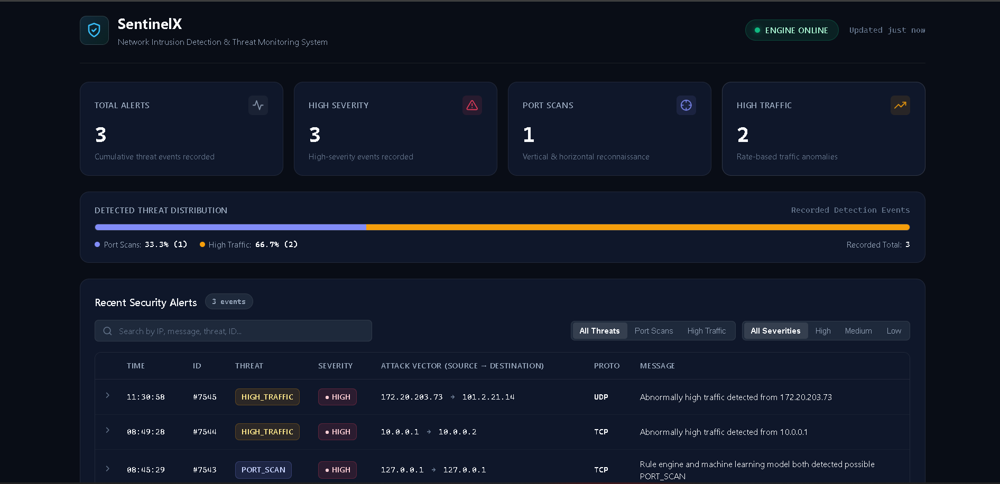

# SentinelX

## Network Intrusion Detection & Threat Monitoring System

SentinelX is a lightweight, hybrid network intrusion detection and threat monitoring system built with Python. It pairs stateful, rule-based heuristics with a secondary machine-learning confirmation layer, decoupled producer-consumer queueing, dual SQLite and JSONL persistence, a secured Flask REST API, and a zero-dependency web-based security operations console.

The project demonstrates practical cybersecurity engineering concepts including real-time network traffic analysis, flow tracking, multi-worker packet processing, cryptographic model verification, defensive API security, and robust alert management.

---



---

## Core Capabilities

- **Real-Time & Offline Processing:** Captures live traffic via Scapy or replays packet capture (.pcap) files.
- **Decoupled Architecture:** High-throughput producer-consumer queueing isolating capture from detection.
- **Stateful Heuristics:** Sliding-window vertical and horizontal TCP SYN port scan detection and volumetric traffic anomaly detection.
- **Optional Flow-Level ML (off by default):** A flow-based model trained and tested on real labelled traffic; it only enters the alert path if it beats rules-only on held-out data (see `docs/ML_REPORT.md`). Signed `skops` artifacts, never pickle.
- **Dual Persistence:** Append-only JSON Lines (`alerts.jsonl`) with size-based rotation and transactional SQLite storage in WAL mode.
- **Defensive API:** Hardened Flask REST endpoints with strict CORS lockdown, parameterized SQL, and defensive security headers.
- **Modern Security Console:** Responsive, single-file dashboard with dynamic filtering, live telemetry, forensic inspection drawer, and XSS-immune DOM rendering.

---

## System Architecture

SentinelX uses a decoupled **Producer-Consumer** architecture designed to isolate packet capture from downstream processing, reduce capture-path blocking, and provide bounded backpressure with explicit drop accounting:

```text
               +--------------------------------------------+
               |  Network Interface (Live) or PCAP Replay   |
               +--------------------------------------------+
                                     |
                                     v
                       +---------------------------+
                       |  Packet Capture (Producer)|
                       |   Fast non-blocking put   |
                       +---------------------------+
                                     |
                                     v
                       +---------------------------+
                       |   Bounded FIFO Queue      |
                       |  (Default maxsize: 10,000)|
                       +---------------------------+
                                     |
                                     v
                       +---------------------------+
                       | Consumer Worker Thread(s) |
                       |    (--workers 1 to N)     |
                       +---------------------------+
                                     |
                                     v
                       +---------------------------+
                       |  Packet Parser & Filters  |
                       |   (IPv4 / IPv6, TCP/UDP)  |
                       +---------------------------+
                                     |
                                     v
                       +---------------------------+
                       |   Stateful Rule Engine    |
                       +---------------------------+
                        /                         \
                       v                           v
        +----------------------------+   +-----------------------------+
        |   Port Scan Detection      |   | High-Traffic Rate Detection |
        | - Vertical (>=10 ports/10s)|   | - Packet Count (>=1000/5s)  |
        | - Horizontal (>=10 hosts)  |   | - Packet Rate (>=200 pps)   |
        | - TCP SYN only; Cooldown   |   | - Byte Rate (>=2.0 MB/s)    |
        +----------------------------+   +-----------------------------+
                        \                         /
                         v                       v
                          Suspicious Threat Event
                                     |
                                     v
                       +---------------------------+
                       | Optional flow ML (gated,  |
                       | additive only, default off)|
                       +---------------------------+
                                     |
                                     v
                       +---------------------------+
                       |       Alert Logger        |
                       +---------------------------+
                        /                         \
                       v                           v
        +-----------------------------+   +-----------------------------+
        |  Append-Only JSONL Log      |   |  SQLite Database            |
        |  (logs/alerts.jsonl)        |   |  (database/sentinelx.db)    |
        |  - 10 MB size-based rotation|   |  - WAL mode enabled         |
        |  - Up to 5 backup archives  |   |  - Thread-safe persistence  |
        +-----------------------------+   +-----------------------------+
                                                         |
                                                         v
                                          +-----------------------------+
                                          |  Hardened Flask REST API    |
                                          |  - CSP & Permissions-Policy |
                                          |  - CORS & Parameterized SQL |
                                          +-----------------------------+
                                                         |
                                                         v
                                          +-----------------------------+
                                          | Security Operations Console |
                                          | (XSS-Safe DOM Dashboard)    |
                                          +-----------------------------+
```

---

## Detection Capabilities

### 1. Vertical Port Scan
Detects a single source IP scanning multiple ports on a targeted destination host:
- **Threshold:** $\ge 10$ unique destination ports targeted on the same host within a 10.0-second sliding window.
- **Traffic Scope:** Evaluates only TCP SYN connection probes (`tcp_syn == True`). Normal established TCP traffic (ACK/PSH) and UDP packets are safely ignored.
- **Alert Suppression:** 30.0-second cooldown window per source/target pair prevents alert floods during sustained sweeps.

### 2. Horizontal Port Scan
Detects a single source IP sweeping a specific port across multiple destination hosts:
- **Threshold:** $\ge 10$ unique target hosts probed on the same destination port within a 10.0-second sliding window.
- **Traffic Scope:** Evaluates only TCP SYN connection probes.
- **Alert Suppression:** 30.0-second cooldown window per source/port pair.

### 3. Volumetric High-Traffic Anomalies
Detects abnormal network spikes from a single source host based on count, packet rate, or byte throughput:
- **Thresholds:**
  - Packet count $\ge 1,000$ packets within a 5.0-second observation window, OR
  - Packet rate $\ge 200.0$ packets/second (with $\ge 50$ packets observed), OR
  - Byte rate $\ge 2,000,000$ bytes/second ($2.0\text{ MB/s}$, with $\ge 50$ packets observed).
- **Traffic Scope:** Inspects unicast TCP and UDP traffic; automatically filters broadcast (`255.255.255.255`) and multicast (`224.0.0.0/4`).
- **Alert Suppression:** 30.0-second cooldown period; resets active tracking once traffic volume drops below 200 packets.

### 4. Memory Bounding & State Pruning
- Stateful host tracking in `FlowTracker` is bounded by default to 10,000 entries (`MAX_TRACKED_ENTRIES`).
- Inactive hosts are pruned via opportunistic TTL sweeps (60.0-second TTL).
- If capacity is exceeded, an LRU eviction algorithm safely purges the oldest inactive hosts.

---

## Flow-Level Machine Learning (optional, default off)

The earlier single-packet model was removed: it was trained on data generated by the same rules it was meant to
confirm (circular). It is replaced by a flow-level model that is trained and tested on real labelled traffic, or
it stays out of the runtime path.

- **Flows, not packets:** one shared extractor (`ml/flows.py`) builds bidirectional flows by event time with a bounded table; the same code produces training rows and serving vectors. Features: `docs/ML_FEATURES.md`.
- **Real data, our labels:** CIC-IDS2017 raw PCAPs, labelled by us from the published attack schedule (`docs/DATASET.md`). Third-party CSV labels are not used.
- **Leakage-safe splits:** by day when a class spans days, otherwise contiguous time blocks with a purge gap of at least twice the flow active timeout. Never random rows.
- **Decision gate:** ML enters the alert path only if rules+ML beats rules-only on held-out recall at equal or lower false alerts per benign hour. The result and the gate decision are generated into `docs/ML_REPORT.md`.
- **Runtime role (only if the gate passed, `SENTINELX_ML=on`):** scores finished flows; may add an `ML_ANOMALY` alert (LOW/MEDIUM) and `ml_score`/`ml_label`. It never suppresses a rule alert.
- **Artifact security:** HMAC-SHA256-signed `skops` file (key from `SENTINELX_MODEL_KEY`), explicit trusted-types list, feature-schema check and a signed gate file bound to the model hash. See the security section of `docs/ML_REPORT.md` for what this does and does not stop.

```bash
python scripts/build_flows.py <pcaps> --out flows.csv.gz
python main.py train --flows flows.csv.gz --out models
python main.py eval --pcap <pcaps> --labels models/test_labels.json --ml-model models --out eval_output
```

---

## Security Hardening

SentinelX includes defense-in-depth security measures across the frontend, API, and detection core:

| Area | Protection Mechanism |
| :--- | :--- |
| **Frontend XSS Immunity** | Dashboard DOM rendering uses exclusively `document.createElement()`, `element.textContent`, and `element.setAttribute()`. Zero use of `innerHTML`, `outerHTML`, or `eval()`. |
| **Content Security Policy** | Restrictive CSP applied via HTTP headers and HTML `<meta>` tag: `default-src 'none'; script-src 'self' 'unsafe-inline'; style-src 'self' 'unsafe-inline'; connect-src 'self' http://127.0.0.1:5000; img-src 'self' data:; frame-ancestors 'none'; base-uri 'none'; form-action 'none';` |
| **Permissions-Policy** | Explicitly disables unused browser APIs: `camera=(), microphone=(), geolocation=(), payment=(), usb=(), bluetooth=(), display-capture=(), clipboard-write=(self)`. |
| **CORS Lockdown** | Access-Control headers restricted to local origins (`http://127.0.0.1:5000`, `http://localhost:5000`). Requests with `Origin: null` are rejected by default. |
| **SQL Injection Prevention** | All SQLite queries use parameterized statements (`?`) with strict input parameter whitelisting for threat types and severity. |
| **Model Artifact Signing** | ML models are `skops` files (no pickle) verified with HMAC-SHA256 (`hmac.compare_digest`) before any deserialization, loaded with an explicit trusted-types list, and gated by a signed PASS decision. |
| **Concurrency Hardening** | Re-entrant locks (`threading.RLock`) and mutex locks synchronize shared state across concurrent worker threads with an acyclic lock hierarchy, preventing race conditions. |
| **DoS-Resistant Logging** | Append-only JSON Lines with size-based rotation prevents disk exhaustion and eliminates $O(N^2)$ full-file rewrites. |

---

## Alert Logging & Data Storage

- **JSON Lines (`logs/alerts.jsonl`):** Default runtime logging writes one JSON object per line using append-only file operations. Rotates automatically when reaching 10 MB, retaining up to 5 numbered backup files (`alerts.jsonl.1` through `.5`).
- **Legacy Compatibility:** Seamlessly supports legacy JSON array logging if `SENTINELX_ALERT_LOG` explicitly ends in `.json`.
- **SQLite Database (`database/sentinelx.db`):** Stores structured alert records transactionally with Write-Ahead Logging (`WAL`) enabled for high-concurrency read/write operations.

---

## REST API Endpoints

The Flask REST API provides structured endpoints for security dashboards and integration:

| Endpoint | Method | Description | Cache Policy |
| :--- | :---: | :--- | :--- |
| `/health` | `GET` | Service status and SQLite database connectivity check | `no-store` |
| `/api/health` | `GET` | Telemetry heartbeat endpoint polled by dashboard | `no-store` |
| `/api/stats` | `GET` | Atomic aggregation of `total_alerts`, `high_severity`, `port_scans`, and `high_traffic` counts | `no-store` |
| `/api/alerts` | `GET` | Fetches alert records with bounded pagination and optional filtering | `no-store` |

### Alert Query Parameters
- `limit`: Number of alerts to return (default: `100`, maximum: `500`).
- `offset`: Offset index for pagination ($\ge 0$).
- `threat_type`: Filter by canonical threat (`PORT_SCAN`, `HIGH_TRAFFIC`).
- `severity`: Filter by severity level (`HIGH`, `MEDIUM`, `LOW`).
- `source_ip`: Filter by attacker IP address.

---

## Getting Started

### Prerequisites
- Python 3.10 or higher
- WinPcap or Npcap (on Windows, for live packet sniffing) or `libpcap` (on Linux)

### Installation
```bash
# Clone the repository
git clone https://github.com/vigneshs-17/SentinelX.git
cd SentinelX

# Set up a virtual environment
python -m venv .venv
source .venv/bin/activate   # On Linux/macOS
.\.venv\Scripts\activate     # On Windows

# Install pinned dependencies
pip install -r requirements.txt
```

### Running SentinelX

#### 1. Live Packet Capture (Default)
Starts the background API and monitors network traffic on the default interface:
```bash
python main.py
```

#### 2. Multi-Worker Execution
Processes packets concurrently across multiple worker threads:
```bash
python main.py --workers 2
```

#### 3. Specific Interface Capture
Specifies a network interface by name:
```bash
python main.py --interface "Ethernet"
```

#### 4. Offline PCAP Replay Mode
Replays an existing packet capture file through the pipeline without requiring live network access:
```bash
python main.py --mode pcap --pcap path/to/sample.pcap
```

Once started, access the Security Operations Console in your browser:
```text
http://127.0.0.1:5000/
```

---

## Verification & Testing

SentinelX includes a comprehensive automated test suite with automated tests covering detection logic, the flow/ML code path, API contracts, security hardening, and multi-worker concurrency, along with automated CI quality gates:

```bash
# Run the full test suite
pytest -v

# Run with quiet summary
pytest -q

# Run performance benchmarks
pytest -s tests/test_performance_benchmark.py

# Run code quality linting (Ruff)
ruff check .

# Run static application security testing (Bandit)
bandit -c bandit.yaml -r backend capture config database detection eval logs ml scripts main.py

# Run dependency vulnerability audit (pip-audit)
pip-audit -r requirements.txt
```

---

## Project Structure

```text
SentinelX/
├── backend/                  # Flask REST API and HTTP handlers
│   └── api.py                # Endpoints, security headers, CORS, and query logic
├── capture/                  # Packet acquisition and ingestion pipeline
│   ├── packet_capture.py     # Scapy capture callback and sniffer control
│   ├── packet_parser.py      # Resilient IPv4/IPv6 and protocol parsing
│   ├── pcap_replay.py        # Offline PCAP replay functionality
│   ├── pipeline.py           # Decoupled Producer-Consumer queue & worker threads
│   └── metrics.py            # Throughput and drop rate accounting
├── config/                   # Centralized configuration and environment settings
│   └── settings.py           # Thresholds, timeouts, and security settings
├── dashboard/                # Security operations console
│   └── index.html            # Single-page dashboard with XSS-safe DOM rendering
├── database/                 # SQLite storage layer
│   ├── database.py           # Database connection management and schema migration
│   └── sentinelx.db          # Production alert database
├── detection/                # Stateful detection engines
│   ├── engine.py             # Central DetectionEngine orchestrating all detectors
│   ├── state_store.py        # Partitioned BoundedStateStore with LRU & event TTL
│   ├── alert.py              # Strongly-typed Alert dataclass
│   ├── utils.py              # Deterministic network & IP utilities
│   ├── scoring.py            # Alert severity and confidence scoring
│   └── detectors/            # Modular stateful detectors (port scan, slow scan, syn flood, volumetric)
├── logs/                     # Alert persistence
│   ├── alert_logger.py       # Append-only JSONL logger with automatic rotation
│   └── alerts.json           # Legacy alert log
├── ml/                       # Optional flow-level ML (default off, gated)
│   ├── flows.py              # Shared flow extractor + feature definitions
│   ├── dataset.py            # Attack-schedule loading and flow labelling
│   ├── splits.py             # Leakage-safe split planner (day / time blocks / purge gaps)
│   ├── model.py              # Train, calibrate, evaluate, permutation importance
│   ├── artifact.py           # Signed skops artifacts, gate file, trusted types
│   ├── runtime.py            # Additive-only serving hook (SENTINELX_ML=on)
│   ├── evaluate.py           # Flow and alert-level metrics, decision gate
│   ├── build.py, report.py   # PCAP -> flows.csv.gz, report rendering
│   └── schedules/            # Published attack schedules (JSON)
├── scripts/                  # build_flows.py, gen_ml_report.py, bench.py
└── tests/                    # Automated test suite
```

---

## License
MIT License. See [LICENSE](LICENSE) for details.